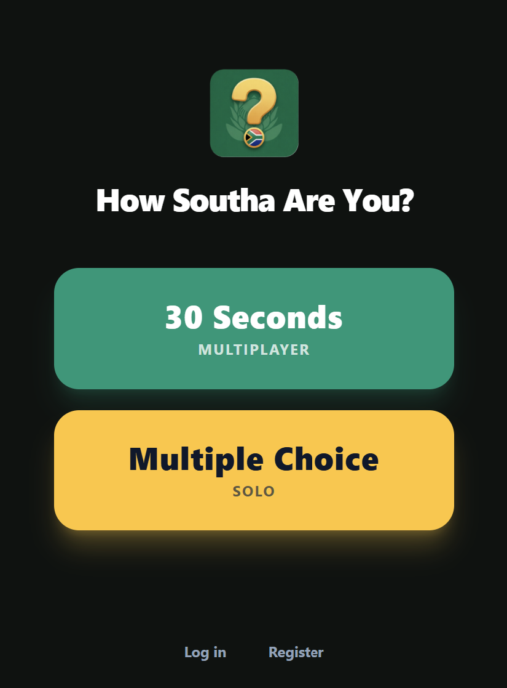
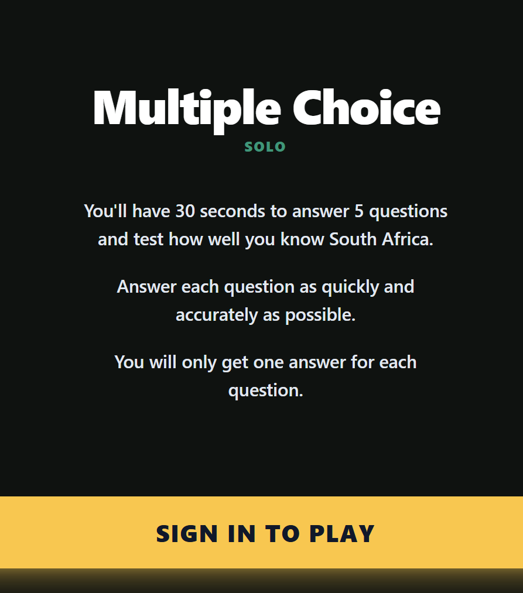
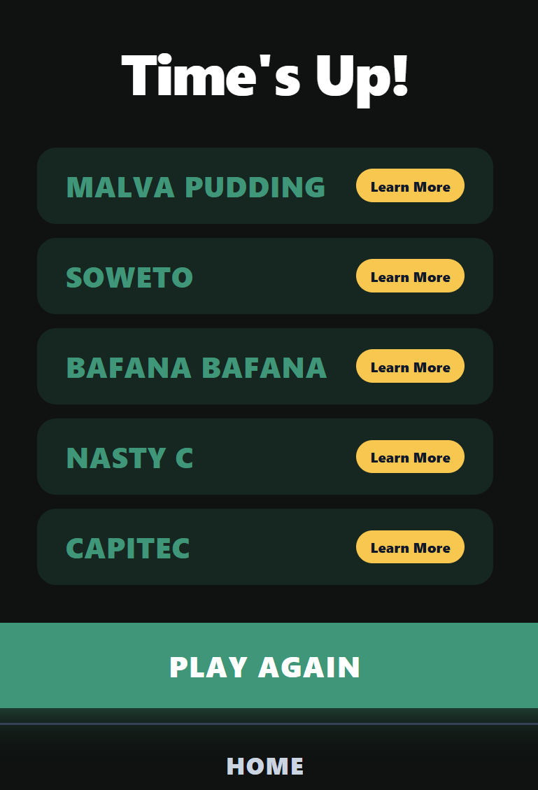
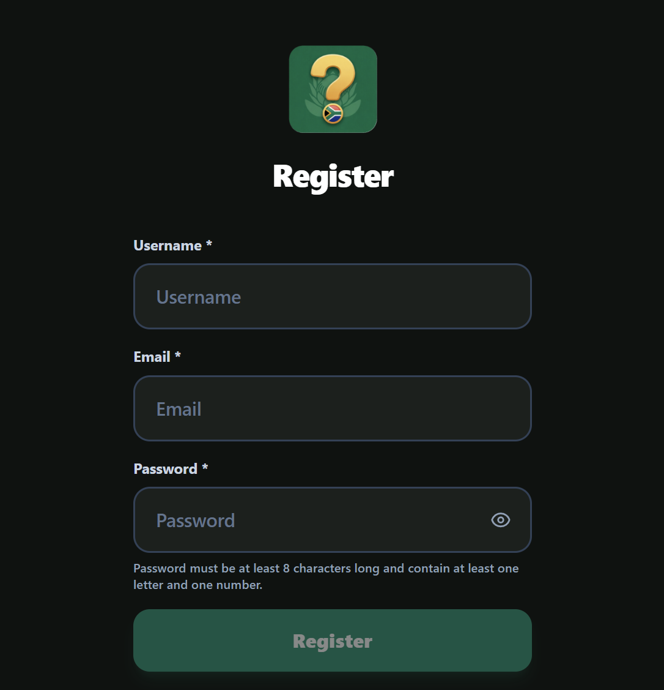
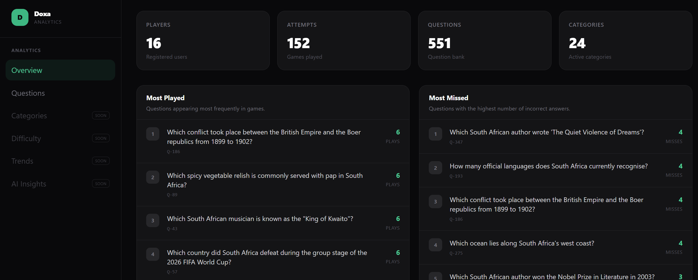

# How Southa Are You?

A South African trivia and party game web application built with a Spring Boot backend, SvelteKit frontend, and Neon PostgreSQL database, accompanied by a dedicated analytics and AI insights layer (Doxa).



## Features

* **Multiple Game Modes:** Test your South African heritage with various trivia rules and fast-paced rounds.
* **Responsive SvelteKit Frontend:** Optimized for desktop and mobile devices.
* **Spring Boot API:** Robust backend handling game state, users, categories, and attempts.
* **Doxa Analytics Layer:** Dedicated FastAPI and Svelte dashboard tracking game questions and statistics.

---

## Screenshots

| Homescreen | Game Rules |
| :---: | :---: |
|  |  |

| Gameplay | Registration / Auth |
| :---: | :---: |
|  |  |

| Analytics Dashboard (Doxa) |
| :---: |
|  |

---

## Tech Stack

* **Frontend:** SvelteKit, TypeScript, Tailwind CSS
* **Backend:** Spring Boot (Java), Maven
* **Analytics:** FastAPI (Python), Svelte
* **Database:** PostgreSQL (Neon)

---

## Running Locally

### 1. Backend
```bash
cd backend
./mvnw spring-boot:run
```

### 2. Frontend
```bash
cd frontend
npm install
npm run dev
```

### 3. Analytics
```bash
cd analytics/backend
uv run uvicorn app.main:app --reload

cd analytics/frontend
npm install
npm run dev
```

---

## Troubleshooting & Deployment Gotchas

When deploying the SvelteKit frontend to Cloudflare Pages and the Spring Boot backend to Render, we encountered and resolved several key issues:

1. **CORS Policy Restrictions:**
   * **Issue:** Preflight `OPTIONS` requests from Cloudflare Pages preview/workers domains were blocked by the Spring Boot backend.
   * **Fix:** Ensure `APP_CORS_ALLOWED_ORIGINS` in Render's environment variables includes your exact Cloudflare Pages / Workers domains (or `*` for testing).

2. **API Base URL Mismatch:**
   * **Issue:** `PUBLIC_API_BASE_URL` in `wrangler.jsonc` was missing `/api/v1`, leading to 404 errors on API routes.
   * **Fix:** Configured `PUBLIC_API_BASE_URL=https://southagame.onrender.com/api/v1` in both `.env` and `wrangler.jsonc`.

3. **Render Cold Starts & Waiting Room:**
   * **Issue:** Render free-tier instances spin down after inactivity, causing initial connection failures.
   * **Fix:** Implemented an offline waiting room (`waiting.html`) featuring 30 random South African trivia questions, background health check polling (`/api/v1/health`), and gated access (disallowing full game or login navigation until the server returns `200 OK`).

4. **MCQ Scoring Display:**
   * **Issue:** Game-over screen displayed raw weighted score points over total questions (e.g. `16 / 5 Points`).
   * **Fix:** Updated the frontend to display correct answers out of total questions (`4 / 5 Correct`).
